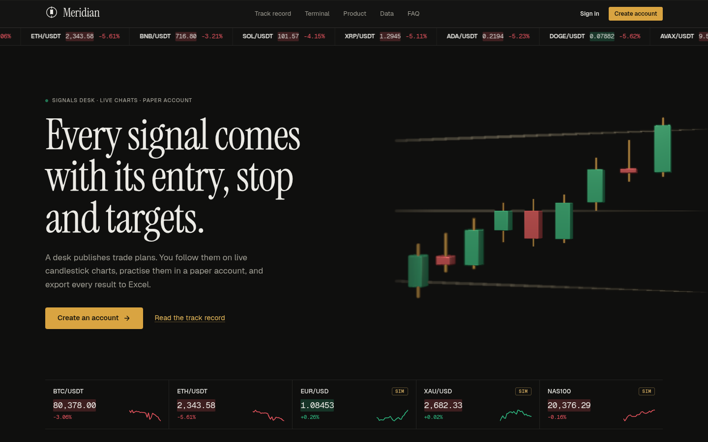
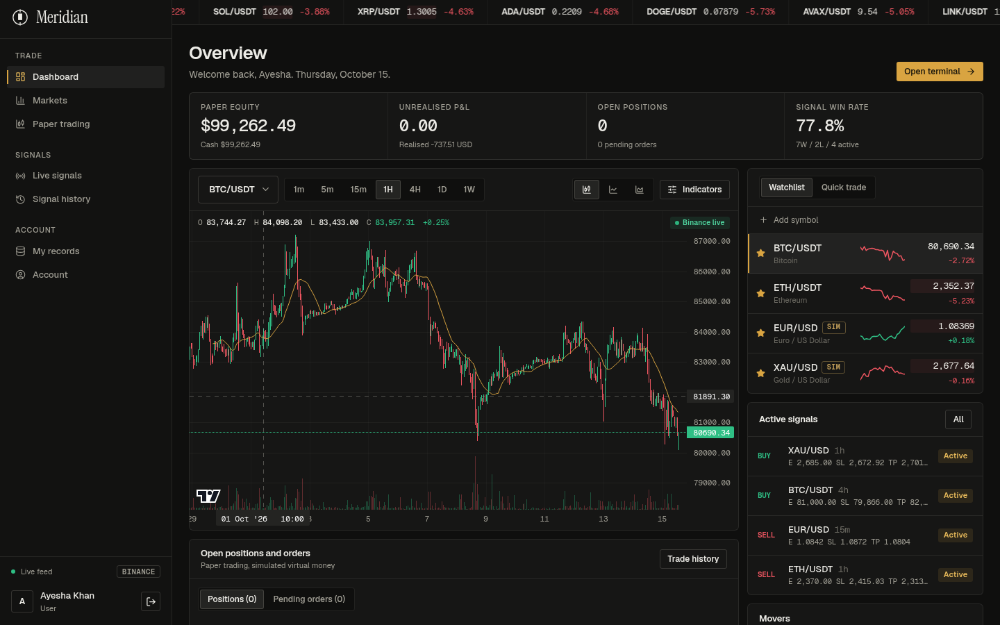
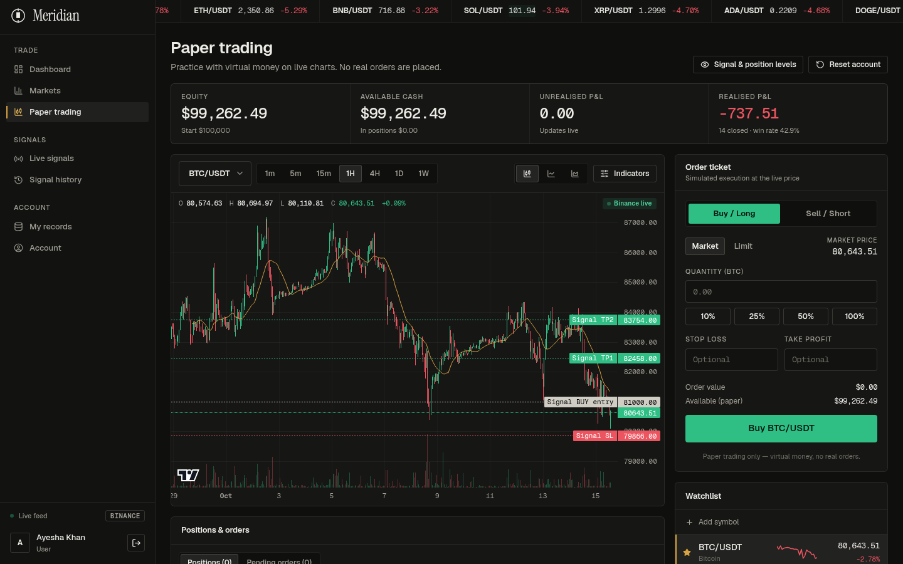
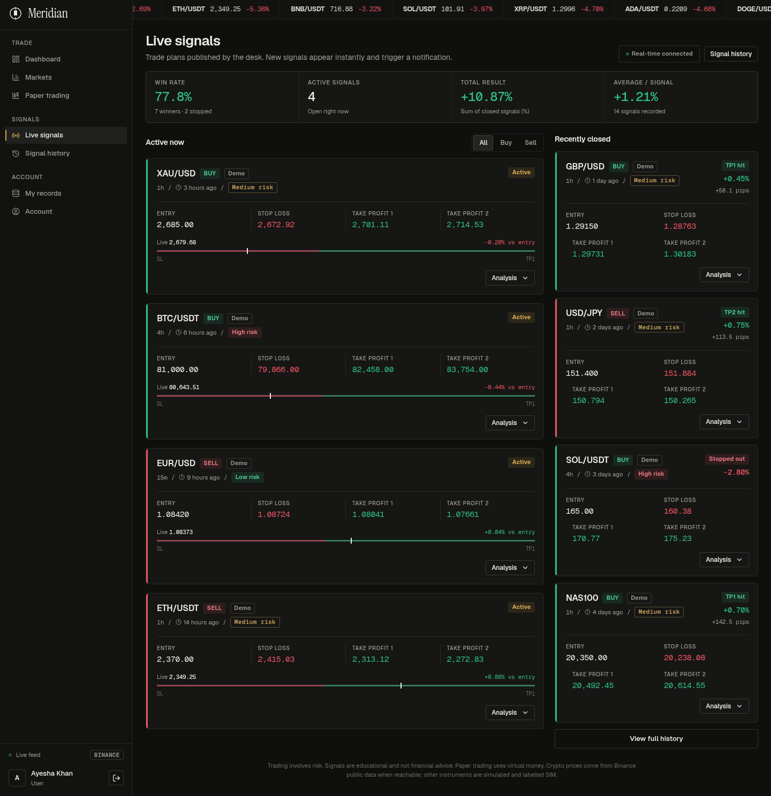
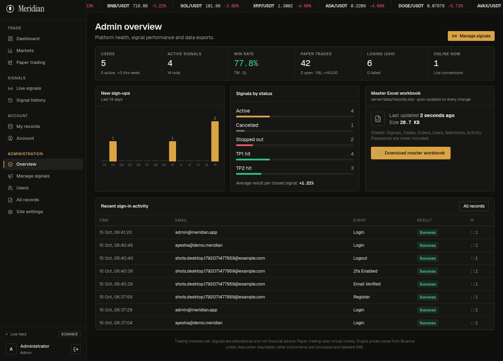

<div align="center">

# Meridian

**A full-stack trading signals and paper-trading platform.**
Admins publish signals, members receive them live, practise on a virtual account, and export every record to Excel.

React 19 · Vite · Node · Express · SQLite · WebSockets · Excel export

</div>



---

## Why Meridian

Most signal groups run on chat screenshots and spreadsheets. Meridian puts the whole workflow in one place: an admin posts a signal with entry, stop loss and targets, every member sees it instantly on a live chart, and every signal, trade and login is stored and exportable. Trading is **paper only (virtual money)**. Nothing here places real orders.

## Features

**For members**
- Live candlestick charts with symbol and timeframe switching, plus MA, EMA, Bollinger Bands, volume and RSI
- Real-time signal cards and toast alerts over WebSockets
- Paper-trading terminal: market and limit orders, stop loss and take profit, live profit and loss, trade history
- Watchlist saved per user, market movers, heat map and crypto news
- Signal history with filters and win-rate stats
- Download Excel on every list

**For admins**
- Create, edit, close, cancel and delete signals (pair, direction, entry, SL, TP1/TP2, timeframe, risk, notes, optional image)
- User management: verification status, 2FA, lockout, force password reset, disable or enable
- **Ads & Media** settings: hero video (link or MP4 upload up to 25 MB) and up to four ad slots
- Master workbook `records.xlsx` rebuilt automatically after every change (Signals, Trades, Orders, Users, Watchlists, Activity)

**Accounts and security**
- Register with email verification, sign in by email or username, forgot and reset password
- Short-lived access token plus rotating httpOnly refresh cookie, with a session list per device
- Optional TOTP two-factor authentication with backup codes
- Account lockout, per-IP rate limits, helmet security headers, bcrypt password hashing
- Security emails for password changes, new devices and email changes

**Design**
- Warm graphite theme with a single amber accent, Geist and Instrument Serif type, self-hosted fonts
- A lazy-loaded 3D hero (react-three-fiber) with an SVG fallback when WebGL is unavailable
- Responsive down to mobile

## Screenshots

| Dashboard | Paper trading |
|---|---|
|  |  |

| Signals | Admin overview |
|---|---|
|  |  |

## Tech stack

| Layer | Tools |
|---|---|
| Frontend | React 19, Vite, React Router, Zustand, Framer Motion, lightweight-charts, react-three-fiber and drei, TanStack Table, Tailwind CSS 4, lucide-react |
| Backend | Node.js, Express, SQLite (built-in `node:sqlite`), JWT, bcryptjs, zod, helmet, socket.io, exceljs, nodemailer, qrcode |
| Data | Binance public API for crypto prices and candles, Cointelegraph RSS for news. Forex, gold, indices and stocks are simulated and labelled **SIM** |

## Quick start

You need **Node.js 22.5 or newer** and npm. There is no database server to install: SQLite is a single file.

```bash
git clone <your-repo-url>
cd meridian
npm install
cp .env.example .env       # on Windows PowerShell: Copy-Item .env.example .env
npm run dev
```

- Site: http://localhost:5173
- API: http://localhost:4000

For a production build, run `npm run build` then `npm start`. Express then serves the built site and the API together on http://localhost:4000.

### Demo accounts

The first run seeds labelled demo data (set `SEED_DEMO=false` for an empty site).

| Role | Email | Password |
|---|---|---|
| Admin | `admin@meridian.app` | the `ADMIN_PASSWORD` value in `.env` (the example file sets `Admin#Demo2026`; keep it in quotes) |
| Member | `ayesha@demo.meridian` | `Demo@12345` |

The admin password only applies when the admin account is first created. Change it afterwards from the Account page. The admin panel is at `/admin`.

## Project structure

```
meridian/
├── client/                 React + Vite frontend (port 5173 in development)
│   └── src/
│       ├── pages/          Landing, auth, dashboard, signals, trading, admin pages
│       ├── components/     Charts, 3D hero, tables, layout
│       ├── store/          Zustand state
│       └── lib/            API client, helpers
├── server/                 Express backend (port 4000)
│   ├── src/
│   │   ├── routes/         auth, signals, trading, market, watchlist, admin, exports
│   │   ├── services/       email, security, trading engine, Excel, market data
│   │   ├── db.js           SQLite schema and migrations
│   │   └── sqlite.js       small wrapper around node:sqlite
│   ├── tests/              API test suite
│   └── data/               created at runtime: database, uploads, outbox, records.xlsx
├── screenshots/            images used in this README
├── .env.example            every setting, commented
└── package.json            npm workspaces (client and server)
```

## Configuration

Copy `.env.example` to `.env`. Every value is optional. The most useful ones:

| Variable | Purpose |
|---|---|
| `ADMIN_EMAIL`, `ADMIN_PASSWORD` | Admin account, created on first run. A changed `ADMIN_PASSWORD` is applied on the next start. Wrap a password containing `#` in quotes |
| `APP_URL` | Public address of the site, used for links inside emails |
| `SMTP_HOST`, `SMTP_PORT`, `SMTP_USER`, `SMTP_PASS`, `MAIL_FROM` | Real email delivery |
| `REQUIRE_EMAIL_VERIFICATION` | `false` lets unverified users use signals and trading |
| `REQUIRE_ADMIN_2FA` | `true` forces admins to set up two-factor authentication |
| `SEED_DEMO` | `false` starts with an empty site |
| `DATA_DIR` | Move the database, uploads and Excel file elsewhere |
| `DATABASE_URL` | PostgreSQL connection string for hosting. All data is stored there and restored on start |

### Email

With `SMTP_HOST` empty, nothing is sent. Every email is printed in the server console, saved as an HTML file in `server/data/outbox/` and listed in **Admin > Email**, which is handy for testing verification and reset links. Admin > Email also shows whether SMTP is configured and has a **Send test email** button.

For Gmail, turn on 2-Step Verification, create an App Password, then set:

```
SMTP_HOST=smtp.gmail.com
SMTP_PORT=587
SMTP_USER=you@gmail.com
SMTP_PASS=your-16-character-app-password
MAIL_FROM="Meridian <you@gmail.com>"
```

Any SMTP provider works the same way (Brevo, Mailgun, Postmark, Amazon SES, Zoho). Restart the server after editing `.env`.

## Scripts

| Command | What it does |
|---|---|
| `npm run dev` | Frontend and backend with hot reload |
| `npm run build` | Build the frontend |
| `npm start` | Run the server (serves the built frontend) |
| `npm test` | Run the API tests |
| `npm run seed` | Re-run the demo seeder (only fills an empty database) |

## Deployment notes

The whole site runs as **one Node app**: `npm run build` builds the client, `npm start` serves the client,
the API and socket.io on `$PORT`. Step-by-step instructions for Hostless are in [DEPLOY_HOSTLESS.md](DEPLOY_HOSTLESS.md).

- On hosts without a persistent disk (Hostless free tier, Render free, Heroku-style dynos) set `DATABASE_URL`
  to a PostgreSQL database and set `JWT_SECRET`. The app keeps working with SQLite in memory/temp storage, writes
  every change to PostgreSQL before answering the request, and rebuilds itself from PostgreSQL on each start.
  Uploaded signal images and the hero video are stored there too. Run a single instance.

- Without `DATABASE_URL`, back up `server/data/`: it holds the database, uploads and the Excel workbook.
- Set a strong `ADMIN_PASSWORD`, a real `APP_URL` (an `https://` address turns on secure cookies), and SMTP settings.
- Keep `REQUIRE_ADMIN_2FA=true` in production.

## Disclaimer

Meridian is an educational project. Signals are not financial advice, trading involves risk, and all trading in the app is simulated with virtual money. Prices for non-crypto markets are simulated and marked **SIM**.

## License

Add a license of your choice (for example MIT) before publishing.
